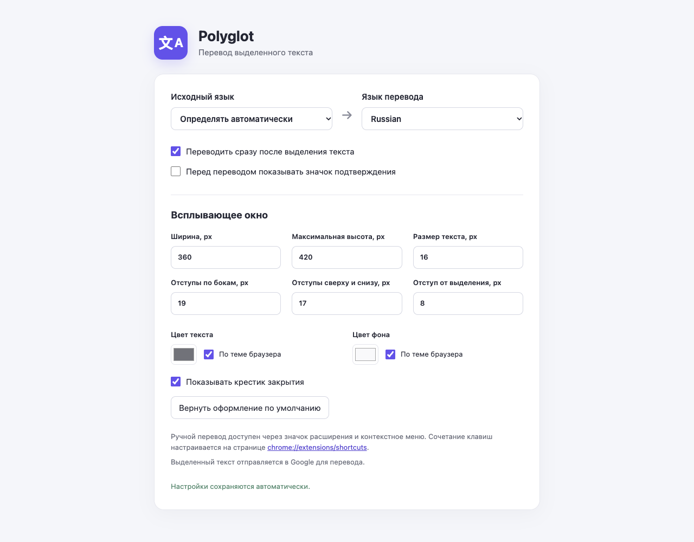

  

<h1 align="center">Polyglot for Chrome</h1>

Перевод выделенного текста во всплывающем окне прямо на странице.

  <a href="https://github.com/nekl3103/Polyglot-for-Chrome/releases/latest/download/polyglot-for-chrome.zip"><strong>Скачать готовое расширение (ZIP)</strong></a>
  · <a href="https://github.com/nekl3103/Polyglot-for-Chrome/releases/latest">Открыть последний релиз</a>

## Возможности

- Выделите текст — окно перевода появится рядом с выделением. Во время запроса показывается индикатор загрузки.
- Исходный язык определяется автоматически; язык перевода по умолчанию — русский.
- Перевод можно вызвать вручную значком расширения, через контекстное меню или сочетанием клавиш.
- В настройках доступны языки, мгновенный перевод, значок подтверждения и оформление окна: ширина, максимальная высота, размер и цвет текста, фон, отступы и крестик закрытия.
- Настройки применяются на открытых вкладках при следующем переводе. Открытое окно перевода тоже обновляется при их изменении.

## Установка из готового релиза

1. [Скачайте ZIP последнего релиза](https://github.com/nekl3103/Polyglot-for-Chrome/releases/latest/download/polyglot-for-chrome.zip) и распакуйте его.
2. Откройте в Chrome страницу `chrome://extensions` и включите **Режим разработчика**.
3. Нажмите **Загрузить распакованное расширение** и выберите папку `polyglot-for-chrome` внутри распакованного архива. В выбранной папке должен лежать файл `manifest.json`.
4. Обновите открытые страницы, на которых собираетесь переводить текст.

Для обновления расширения скачайте новый ZIP, замените содержимое выбранной при установке папки, нажмите **Обновить** на карточке расширения в `chrome://extensions` и обновите уже открытые страницы.

## Использование и настройки

Выделите слово или фразу на обычной веб-странице. Перевод появится в панели около выделения. Если включён значок подтверждения, нажмите его после выделения. Панель закрывается нажатием на крестик, если он включён, или щелчком вне панели.

Для ручного перевода используйте значок Polyglot на панели Chrome или пункт **Translate selection** в контекстном меню выделенного текста. Сочетание клавиш можно назначить или изменить на странице `chrome://extensions/shortcuts`.

Откройте **Управление расширениями → Polyglot for Chrome → Настройки расширения**, чтобы выбрать языки и изменить вид панели. Цвет текста и фона по умолчанию следует светлой или тёмной теме браузера; выбор цвета в палитре включает пользовательский цвет. Кнопка **Вернуть оформление по умолчанию** сбрасывает только оформление.

## Доступ и перевод

Расширению нужен доступ к обычным страницам HTTP и HTTPS, чтобы видеть выделенный текст и показывать панель рядом с ним. Для перевода **только выбранный текст** отправляется в публичный сервис Google. Ключ API и регистрация не требуются. Сервис может ограничивать запросы или менять формат ответа; при ошибке панель показывает сообщение.

На `chrome://` страницах, в Chrome Web Store и некоторых встроенных просмотрщиках Chrome расширения не запускаются.

## Исходный код

Это расширение Manifest V3 без сборщика и внешних библиотек. Основные файлы — `manifest.json`, `content.js`, `background.js` и страница настроек `options.html`. Для локальной установки из исходников выберите папку репозитория через **Загрузить распакованное расширение**.
